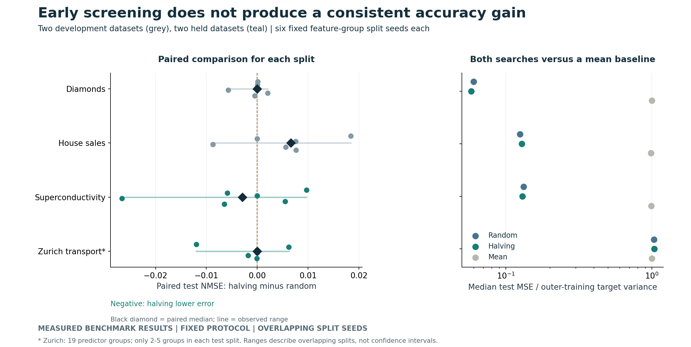
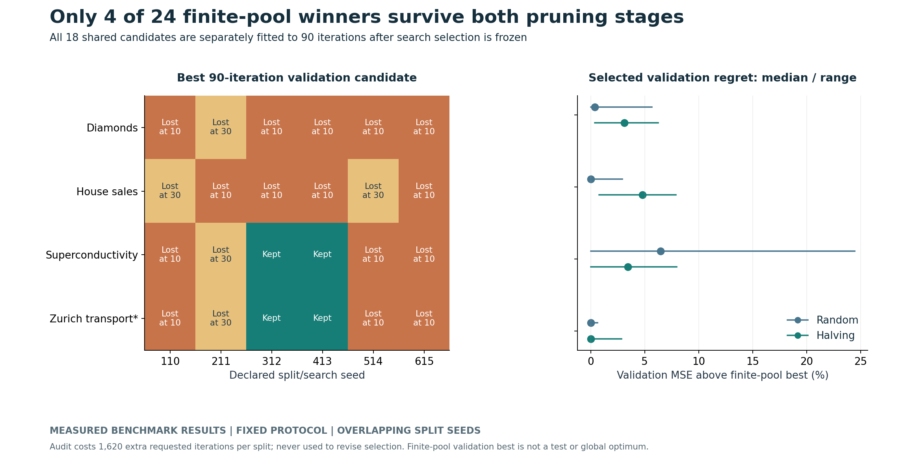
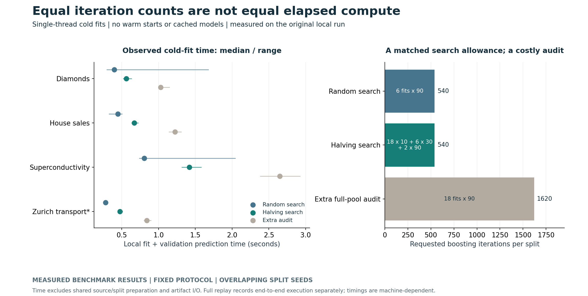

# When does early elimination waste a tuning budget?

**This cold-fit halving schedule did not earn a consistent accuracy or elapsed-time advantage over a smaller full-budget random search.** On two held datasets, it wins three of six split comparisons each, with ties and losses retained. Only 4/24 finite-pool validation winners survive both pruning stages. The useful decision is to validate the early ranking and actual compute cost before adopting the scheduler.

This is original, reproducible experimental code on four exact public benchmark versions, with every trial, prediction, resource ledger and independent MSE check available. Random search and successive halving are established methods; no new optimizer, universal winner or deployment-impact claim is made.



## What the experiment found

Lower paired difference means lower test error for halving. NMSE is test MSE divided by **fit+validation target variance**. Each comparison uses the same source subset, feature-group split and shared candidate pool. The six seeds overlap; their ranges are descriptive, not independent confidence intervals.

| Benchmark subset | Role | Halving wins /6 | Median paired NMSE difference | Observed paired range |
|---|---|---:|---:|---:|
| Diamonds | Development |3|+0.000006|[-0.005676,+0.002036]|
| House sales | Development |1|+0.006601|[-0.008695,+0.018420]|
| Superconductivity | Held dataset |3|-0.002934|[-0.026594,+0.009685]|
| Zurich transport | Held dataset |3|-0.000041|[-0.011988,+0.006194]|

House sales, superconductivity and Zurich have one, one and two exact ties respectively. Diamonds is effectively tied at its paired median despite a lower marginal median for halving: the median paired difference is not the difference of separate medians. This distinction prevents a misleading winner from an aggregate table.

Both searches improve substantially on the fixed training-mean baseline in the first three subsets. In Zurich, the mean baseline has a lower median NMSE than either search, and halving is worse than the mean in three of six splits. More tuning does not establish useful transport prediction. The bounded Zurich table has only **19 predictor groups**, with 2-5 groups per test split; those are not thousands of independent observations.

## An audit of what pruning discarded

A 36-setting HistGradientBoostingRegressor space crosses learning rate {0.03,0.10,0.30},maximum leaves {7,15,31},L2 {0,1} and minimum leaf observations {10,30}. For each dataset/seed, a fixed permutation supplies 18 candidate settings to both strategies. No pretrained-model fine-tuning is claimed.

- **Random:** fit the first 6 candidates at 90 boosting iterations.
- **Halving:** fit 18 at 10 iterations, promote 6 to 30, then 2 to 90.
- **Selection:** lowest final-stage validation MSE, ties by candidate ID. Each fit starts cold. Target centering/scaling uses fitting labels only; final refits use fit+validation only. Predictor groups never cross fit/validation/test boundaries.
- **Extra audit:** after selection is frozen, fit all 18 at 90 iterations, without changing either selected configuration.

Each search requests 540 iterations. The audit requests an additional 1,620 per split, explicitly outside both search allowances. Its best candidate is a **finite-pool validation reference**, not a test oracle or a global optimum across the 36-setting space. Fifteen of 24 such winners are lost at the first pruning stage; five more are lost at the second. The final survivors occur only in the two held datasets. Retained trials quantify regret rather than hiding unsuccessful candidates.



The [protocol](PROTOCOL.md), source/rights and method were committed before fitting. Development selections were frozen at `16f6b005b5e3aac3fd0be5edbb6e9508bcdb8596`; held-dataset selections at `eb3d301c86383c21fbbedaf9a420a8afba74d639`, each before its test-scoring command. Test outcomes did not alter candidates, budgets, thresholds, splits or selections. The extra audit never selects the final test model.

## Compute accounting that can be inspected

An equal iteration count is not equal FLOPs, energy, wall time or money. Halving executes 26 cold fits versus 6 for random search, with varying tree sizes and repeated setup. The study does not isolate which component causes each timing difference, nor test warm-start/cached alternatives.

| Original local single-thread run | Random fit+prediction median(s) | Halving median(s) | Extra audit median(s) |
|---|---:|---:|---:|
| Diamonds |0.397|0.564|1.030|
| House sales |0.449|0.670|1.223|
| Superconductivity |0.808|1.418|2.647|
| Zurich transport |0.282|0.475|0.843|

These sums exclude shared source/split preparation and artifact I/O. Strategy order alternates by seed, but cold-start effects, runtime noise and fixed execution context still limit timing interpretation. The fresh replay separately records end-to-end execution, including verification and figures. Timings are measured outputs, excluded from numerical equality checks and not portable cost estimates. No paid compute was used.



## Sources and the boundary of the claim

[Source records and rights](SOURCES.md) retain exact OpenML IDs/versions, original creators, declared public-domain/CC0/CC BY 4.0 terms and the benchmark transformation context. A separate parser reconciles all **5,562,391 source rows**, selected source identities, value deduplication and group-cap construction. The four panels contain 23,911 rows and 15,828 distinct predictor groups in total; they are bounded derivatives, not the full benchmark suite.

The whole-group hash cap and exact full-row value deduplication alter sampling/frequency. They do not establish that repeated source events were erroneous. Grouping identical predictors does not resolve unobserved property identity, related material families or transport route/time dependence. Original-unit correspondence is unverified, so raw errors are reported in distributed benchmark target units rather than asserted dollars, kelvin or time units. Dataset-specific results are not pooled into a universal raw MSE.

The primary contribution is a small auditable search-allocation comparison, with data dependence, finite-pool regret and actual resource accounting visible. Prior work already studies adaptive allocation and tabular benchmarking. Four datasets and six overlapping split seeds cannot establish broad statistical superiority.

## Reproduce the result

Python 3.10; [pinned versions](requirements.txt). Constructor settings and inherited defaults are [recorded separately](results/estimator_environment.json), with no invented optimization rationale.

```sh
python -m pip install -r requirements.txt
python -m unittest discover -s tests -v
python src/verify.py source
python src/verify.py test development
python src/verify.py test held_dataset
python src/verify.py summary
python src/check_reproduction.py
```

The final command rebuilds every search, audit and final refit in a temporary directory and compares all 1,200 validation trial rows, frozen selectors and 72 final metric rows at 1e-7 absolute / 1e-9 relative tolerance. Exact eligible panel bytes make the replay offline. [Raw-source reconciliation](results/verification_source.json) records the independent original-file pass; an offline checkout checks panel/metadata hashes and feature signatures. To repeat the original-source check, run `python src/fetch.py` first; raw ARFF files remain ignored and revised provider bytes must be investigated.

Independent code imports none of the experiment's metric helpers. It checks 1,565,550 validation prediction rows, 81,813 final prediction rows, all promotions, shared pools, 540-iteration search ledgers, 1,620-iteration audit ledgers and every summary. SQL separately checks group/split disjointness and observation accounting. Six contracts test grouping, future-target isolation, candidate sampling, ties, iteration ledgers, overwrite protection and retained failures. Full [trial records](results/runs), [paired comparisons](results/paired_comparisons.csv), [final metric table](results/all_test_metrics.csv), [independent summary checks](results/verification_summary.json) and [fresh replay receipt](results/reproduction.json) remain inspectable.

## Next useful experiment

Test an altered first-stage resource allowance, a wall-time stopping rule or a warm-start implementation under a new frozen protocol and new evaluation data. This experiment does not show which would work. Keep the full-budget random baseline, check whether early ranking is informative on the actual workload, and charge the extra validation audit to the research budget. A private LaTeX/PDF manuscript explains the study; drafts, source papers, raw files and credentials are excluded from GitHub.
